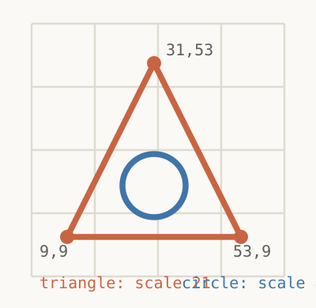
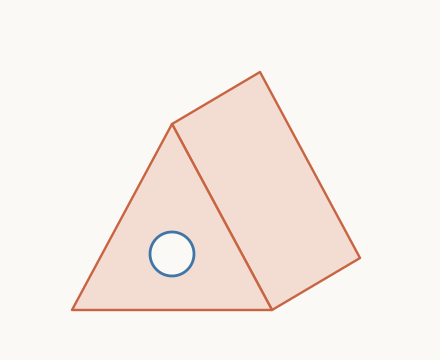
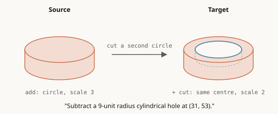

# Open-CAD-Tokenizer — an independent reimplementation

Text-guided CAD generation and editing, built from the paper and tested through actual geometry.

## Why I built this

I waited **eight months** for CAD-Tokenizer to be released. The release I needed still hadn't arrived, so I decided to reimplement it myself.

The idea in [CAD-Tokenizer: Towards Text-based CAD Prototyping via Modality-Specific Tokenization](https://arxiv.org/abs/2509.21150) was too interesting to leave on a reading list: teach a language model to work with CAD primitives, then use the same model to create a design or edit an existing one from a text instruction.

That became this project. We reconstructed the data pipeline, trained tokenizers, aligned them to LLaMA, fine-tuned generation/editing models, and checked the outputs with a CAD kernel. When something failed, we tried to find out whether the problem was compression, decoding, training, geometry, or the instruction itself.

**This is an independent implementation and research record.** It includes working training and evaluation pipelines, useful reconstruction improvements, and failed experiments. We have not reproduced the paper's generation quality, and our experiments changed parts of the original recipe.

## What it does

- **Create:** turn a natural-language instruction into a sketch-and-extrude CAD program.
- **Edit:** take an instruction and an existing CAD program, then generate the replacement program.
- **Compress:** encode CAD primitives into learned discrete tokens and reconstruct their programs.
- **Evaluate:** build the resulting solids, export STEP/STL, and measure validity, structural counts, shape distance, and distribution coverage.

The internal representation is **SEM**, a sequence describing sketches, curves, extrusions, and Boolean operations. The core model consumes and produces these programs; arbitrary imported STEP geometry requires a separate supported conversion or tool route.

```text
CAD programs → primitive VQ-VAE → CAD tokens → LLaMA vocabulary alignment
                                                       ↓
                                  joint generation/editing LoRA training
                                                       ↓
Text instruction + optional source CAD → model → CAD program → kernel → solid
```

There are also a lossless SEM codec, a hybrid codec with exact scale/origin values, a plain-text LLaMA baseline, and separate experimental STEP editing tools.

## How it works: one example, end to end

This is a static version of the interactive walkthrough (the animated page can't run on GitHub). We follow one real training example, a triangular prism with a groove, from a line of CAD text down to **19 tokens** that LLaMA can write, and back into a shape.

### 1. Each example pairs words with a shape

The prepared data holds 140,800 examples. Generation examples give a description and a target shape. Editing examples add a source shape and an edit instruction.

**Example `cadfusion:train:2498`**

> *The 3D shape is a triangular prism with a circular groove in the front. The groove affects the structural integrity of its location.*

<p>


</p>

*Left: the two sketches at their relative size after scaling (triangle ×21 in orange, circle ×8 in blue), so the circle sits inside the triangle. Before scaling, each sketch fills the 64 × 64 grid. Right: a hand-made illustration of the result, not rendered from the CAD kernel.*

It is two sketches, each defined on a 64 × 64 grid and then scaled: a triangle (extruded, `add`) and a circle (extruded as a `cut`) that carves the groove.

> **About that caption.** "The groove affects the structural integrity of its location" carries no geometric information; it is filler from the upstream LLM-written CADFusion annotations. The only usable content is "triangular prism with a circular groove in the front". Captions like this are a reason the README's caption audit matters: many generation captions describe a shape loosely, and many numeric editing captions are underspecified or contradict their targets.

**An editing example with dimensions** (`cad_editor:train:72953`). Editing rows give a source shape and an instruction with numbers:

> *Subtract a 9-unit radius cylindrical hole at (31, 53).*

<p></p>

*Hand-made illustration of the source and target, not rendered from the kernel. The hole is drawn at 2/3 of the disc diameter (scale 2 vs 3); its depth is not verified.*

The source is a single disc: one circle sketch, extruded with `add`. The target keeps that disc and appends a second circle sketch extruded with `cut`, which drills the hole:

```text
# Source: a disc
# Circle sketch: four rim points (31,53) (31,9) (53,31) (9,31), so centre (31,31)
# and radius 22 grid units before scale. It closes its own loop, face and sketch.
circle 31 53 31 9 53 31 9 31 <curve_end> <loop_end> <face_end> <sketch_end>
# Extrude it: add material, extents 31 63, origin (31,31,31), axis-aligned
# orientation, scale 3, offset (30,30).
add 31 63 31 31 31   1 0 0 0 1 0 0 0 1   3 30 30 <extrude_end>

# Target: the same disc, plus a second sketch cut into it
# The disc again, unchanged.
circle 31 53 31 9 53 31 9 31 <curve_end> <loop_end> <face_end> <sketch_end>
add 31 63 31 31 31   1 0 0 0 1 0 0 0 1   3 30 30 <extrude_end>
# The hole's sketch: the identical circle (same centre, same 22-unit radius
# before scale)...
circle 31 53 31 9 53 31 9 31 <curve_end> <loop_end> <face_end> <sketch_end>
# ...but cut (remove material) with scale 2 instead of 3, so the hole is
# 2/3 of the disc's diameter. Same offset (30,30), so it is concentric.
cut 14 31 31 31 63   1 0 0 0 1 0 0 0 1   2 30 30 <extrude_end>
```

The caption's `(31, 53)` is the top point of the circle on the 64 × 64 sketch grid, whereas the target's cut circle has the same centre as the disc (both have offset `30 30`), so the stored hole is concentric, not at that point. The mapping from "9-unit radius" to the stored scale (`3` for the disc, `2` for the hole) is not stated either. A model has to learn those conventions from data, and the caption alone does not pin them down. That ambiguity is typical of the numeric editing captions, and is why a low loss can still produce the wrong edit.

### 2. The shape is stored as a flat sequence (SEM)

This is the format in the database: 66 symbols from a vocabulary of 76.

```text
# ---- Pair 1: the triangle, added ----

# Corner 1 at grid point (9, 9). A "line" gives only its START point; its end
# is the start of the next curve. <curve_end> closes this curve.
line 9 9 <curve_end>
# Corner 2 at (53, 9): the first edge runs (9,9) -> (53,9).
line 53 9 <curve_end>
# Corner 3 at (31, 53): the second edge runs (53,9) -> (31,53).
line 31 53 <curve_end>
# The last edge runs (31,53) -> back to the first corner (9,9), closing the loop.
# <loop_end> closes this ring of curves, <face_end> closes the face, and
# <sketch_end> ends the sketch.
<loop_end> <face_end> <sketch_end>
# Extrusion: add material. 31 63 = the two extents (how far the sketch is pushed
# each way, 0-63), 31 31 31 = origin (x, y, z) of the sketch plane.
add 31 63 31 31 31
# Orientation of the sketch plane: nine values (-1, 0 or 1) giving its axes.
1 0 0 0 0 1 0 -1 0
# scale 21, offset (31, 31): restores the sketch's real size and position
# (see "What are scale and offset?" below). <extrude_end> ends this pair.
21 31 31 <extrude_end>

# ---- Pair 2: the circle, cut ----

# A circle is stored as four points on its rim, written as x y pairs:
#   31 53 and 31 9  -> the two ends of the vertical diameter (top, bottom)
#   53 31 and 9 31  -> the two ends of the horizontal diameter (right, left)
# The centre is where the diameters cross: (31, 31). The radius is half the
# distance between each pair of points: (53 - 9) / 2 = 22 grid units, before scale.
# A circle needs no neighbours, so it closes its own curve, loop, face and sketch.
circle 31 53 31 9 53 31 9 31 <curve_end> <loop_end> <face_end> <sketch_end>
# Extrusion: cut (remove) material, extents 31 36, origin (31, 0, 31).
cut 31 36 31 0 31
# Same orientation as pair 1.
1 0 0 0 0 1 0 -1 0
# scale 8 (much smaller than the triangle's 21), offset (31, 31).
8 31 31 <extrude_end>
```

| Part | Written as | Meaning |
|---|---|---|
| Line | `line x y` | One corner of a straight edge |
| Arc | `arc` + 4 numbers | Two points along a curved edge |
| Circle | `circle` + 8 numbers | Four rim points as `x y` pairs: top, bottom, right, left. Centre = where the two diameters cross; radius = half a diameter. Closes its own loop, face and sketch |
| Extrusion | `add` / `cut` / `intersect` + 17 numbers | Two extents, origin (3), orientation (9), scale, offset (2) |
| Markers | `<curve_end>` `<loop_end>` `<face_end>` `<sketch_end>` `<extrude_end>` | Close a curve, loop, face, sketch, and extrusion |

Sketch coordinates and extents are quantized to 0–63; orientation values are −1, 0 or 1.

**What are `scale` and `offset`?** The last three numbers of each extrusion (for example `21 31 31`) place the sketch in 3D. Every sketch is first normalized so that its curves fill the whole 64 × 64 grid, which keeps the coordinates well-conditioned for the tokenizer. The extrusion then records how to undo that normalization: the geometry worker rebuilds each point as

```text
point_3d = sketch_point × scale + offset        (then rotated/translated by the orientation and origin)
scale    = value × 1.4 / 63                      (value 0–63  →  0 to 1.4)
offset   = value × 1.8 / 63 − 0.9                (value 0–63  →  −0.9 to 0.9; 31 ≈ 0)
```

So a **bigger scale means a bigger real shape**. In the prism example the triangle has scale `21` (≈ 0.47) and the groove circle has scale `8` (≈ 0.18); in the disc-with-hole example the disc has scale `3` (≈ 0.067) and the hole has scale `2` (≈ 0.044), so the hole is 2/3 of the disc's diameter. The offset values (`31`, `30`) shift the sketch sideways in its plane; `31` is almost exactly zero, so these sketches are centred. These are normalized units, not millimetres, so a caption's "9-unit radius" does not correspond to any stored number directly; the model has to learn that mapping from data. Scale and offset are the numbers the tokenizer's quantization blurs, which is why our trailer tokens (step 5) store them exactly.

### 3. Pairs, then primitives

A **pair** is one sketch plus the extrusion that uses it. This shape has two pairs. Each pair is divided into primitive groups: one per curve, and three for the extrusion (operation/extent/origin, orientation, scale/offset).

A **VQ code** is the single number (0–2047) that replaces a whole primitive group. VQ stands for vector quantization; see step 4. The tables below show the code the tokenizer assigned to each group.

| Pair 1 (34 symbols, 6 groups) | VQ code |
|---|---:|
| `line 9 9` | 115 |
| `line 53 9` | 1325 |
| `line 31 53` + closing markers | 1695 |
| `add 31 63 31 31 31` | 1669 |
| orientation (9 values) | 346 |
| `21 31 31` + `<extrude_end>` | 1172 |

| Pair 2 (32 symbols, 4 groups) | VQ code |
|---|---:|
| `circle …` + closing markers | 1723 |
| `cut 31 36 31 0 31` | 349 |
| orientation (9 values) | 204 |
| `8 31 31` + `<extrude_end>` | 926 |

### 4. Each primitive snaps to one of 2,048 codes

A transformer encoder reads a pair and pools each group into one vector. Vector quantization replaces that vector with its nearest entry in a learned codebook of 2,048 codes (the table above). This is what makes the tokenizer lossy: the code keeps the nearest match, not the exact values.

**Common questions**

- **Why do `line 9 9` and `line 53 9` get different codes?** Their coordinates differ, so the encoder produces different vectors, and each snaps to a different codebook entry (`115` and `1325`). The encoder is a transformer that reads the whole pair, so a group's vector also depends on its position and neighbours, not only its own numbers.
- **Are the code numbers meaningful?** No. A code is only an index into the learned codebook. Code `1325` does not mean 1325 units, and nearby codes are not necessarily similar shapes.
- **Can there be more than 2,048 codes?** Not within one trained tokenizer, but the size is a choice. `codebook_size` in [configs/train.json](configs/train.json) is set before VQ training (here 2,048) and then fixed for that tokenizer. A new corner never creates a new code; it snaps to the nearest existing one. A larger codebook would keep more detail, but each code needs its own unique LLaMA token in step 5, and the model has more codes to learn. We only trained with 2,048, so the effect of other sizes is untested here.
- **So do different groups share a code?** Yes, and that is the lossy part. Many different groups map to the same code, and the decoder cannot tell them apart. Sketch coordinates are already limited to a 64 × 64 grid, but whole groups (an extrusion's extents, origin and orientation together) have far more combinations than 2,048. This is why scale and offset get exact trailer tokens in step 5.

### 5. Codes borrow words LLaMA already knows

Alignment gives each code a unique token from LLaMA's existing vocabulary, so no new embeddings are needed. The word itself means nothing; it is only a slot whose embedding sits near the code's projected vector.

| Item | Code | LLaMA token id | Token text |
|---|---|---:|---|
| Line 1 | 115 | 26904 | `peror` |
| Line 2 | 1325 | 6885 | `ga` |
| Line 3 | 1695 | 102540 | `リー` |
| Extrusion start | 1669 | 113814 | `İŞ` |
| Orientation | 346 | 66342 | `peater` |
| Scale group | 1172 | 116500 | `yslu` |
| Trailer: scale 21 | – | 127977 | `alınması` |
| Trailer: offset 31 (×2) | – | 127967 | `امنیت` |

**How a code is assigned its token id** (`train-align`, [cadtokenizer/alignment.py](cadtokenizer/alignment.py)):

1. Two small linear adapters are trained: a forward one that projects a codebook vector (512 dimensions) into LLaMA's embedding space, and a backward one that maps a LLaMA token embedding back to the codebook vector.
2. Each projected vector is scored against every row of LLaMA's output head (its vocabulary logits). The highest-scoring token becomes that code's token. Special tokens and the three boundary tokens are excluded.
3. Training minimizes two errors: the round trip (code vector → token → back to the code vector) and the distance between the projected vector and the chosen token's embedding.
4. Two codes can pick the same token, but the mapping must be one-to-one so the decoder can invert it. If that happens, a deterministic fix (`collision_policy: unique_topk`, our extension) assigns each code its best unused candidate, strongest scores first, and the adapters are refined on the fixed mapping.
5. The result is saved as `alignment.pt`: 2,048 distinct LLaMA token ids, one per code. At inference the table is simply inverted to turn generated tokens back into codes.

**Which file does the translation?** The mapping is stored in `alignment.pt`, written by `train-align` into the `alignment.output` directory of the config (for example `artifacts/alignment/alignment.pt`). It contains:

| Key | Contents |
|---|---|
| `native_ids` | 2,048 LLaMA token ids; position *i* is the token for code *i* |
| `trailer_ids` | the 64 trailer tokens, in bin order (bin value = position) |
| `boundaries` | the token ids for `<start>`, `<pair end>` and `<end>` |
| `reconstructed_code_vectors` | the vector each code decodes to, used by the alignment decoder |

The tokens are looked up by id, not by spelling. Encoding (`cadtokenizer/encode.py`, `cadtokenizer/sft.py`) indexes `native_ids` to turn a code into a token id. Decoding (`decode_native_ids` in [cadtokenizer/inference.py](cadtokenizer/inference.py)) inverts it into a lookup `{token id: code}`, so `peror` (id 26904) maps back to code 115. LLaMA's own tokenizer, saved next to `alignment.pt` in `llm_tokenizer/`, converts between text and token ids.

The three boundary tokens (`<start>`, `<pair end>`, `<end>`) are the first three unused `reserved_special_token_*` ids. The 64 trailer tokens are the highest-numbered unused ids whose embeddings are actually trained. No vocabulary is expanded and no new embeddings are added; the word a token happens to spell has no meaning here.

Quantization blurs a sketch's size and position, so three **trailer** tokens carry the scale and two offsets exactly, using 64 reserved vocabulary slots. The trailer is our addition, not part of the paper.

### 6. Sixty-six symbols become nineteen tokens

Each pair is its codes, then three trailer tokens, then a pair boundary. One end token closes the shape.

```text
peror ga リー İŞ peater yslu  alınması امنیت امنیت  <pair end>
پی *ft moire ean              ์กร امنیت امنیت        <pair end>
<end>
```

The words are arbitrary LLaMA vocabulary entries, so the spelling carries no meaning (step 5). Here is the same sequence in a readable notation, with each token replaced by what it stands for. This is for explanation only; the model never sees this notation.

```text
# Pair 1: the triangle, added
code115 code1325 code1695      <- 3 line corners   (peror ga リー)
code1669                       <- add + extents + origin   (İŞ)
code346                        <- orientation              (peater)
code1172                       <- scale/offset group       (yslu)
scale21 offset31 offset31      <- exact trailer            (alınması امنیت امنیت)
<pair end>

# Pair 2: the circle, cut
code1723                       <- circle   (پی)
code349                        <- cut + extents + origin   (*ft)
code204                        <- orientation              (moire)
code926                        <- scale/offset group       (ean)
scale8 offset31 offset31       <- exact trailer            (์กร امنیت امنیت)
<pair end>

<end>
```

Or as a table:

| Token | Meaning | Token | Meaning |
|---|---|---|---|
| `peror` | code 115 (line 1) | `پی` | code 1723 (circle) |
| `ga` | code 1325 (line 2) | `*ft` | code 349 (cut) |
| `リー` | code 1695 (line 3) | `moire` | code 204 (orientation) |
| `İŞ` | code 1669 (add) | `ean` | code 926 (scale group) |
| `peater` | code 346 (orientation) | `์กร` | trailer: scale 8 |
| `yslu` | code 1172 (scale group) | `امنیت` | trailer: offset 31 |
| `alınması` | trailer: scale 21 | `<pair end>` | pair boundary |

Median output length on the 1,000 test cases (tok2-v1 step 10,696 vs. the second plain-text run): **22 tokens** for the CAD tokenizer versus **178 tokens** for plain text (the same SEM read by the normal LLaMA tokenizer).

### 7. Training row, prompt format and output format

There is no separate system prompt. Each row uses a fixed task template: the prompt (the query) is ordinary text ending in a `<start>` token, and the target (the model's answer) is the CAD tokens that follow, closed by `<end>` and `<eos>`. Prompt tokens are masked from the loss; only the output is trained.

**Generation**

```text
# ---- PROMPT (the query): ordinary text, ends with the <start> token; masked from the loss ----
Task: CAD generation
Instruction: The 3D shape is a triangular prism with a circular groove in the front. …
Output CAD:
<start>
# ---- TARGET (the answer the model writes, and the only part trained on) ----
peror ga リー İŞ peater yslu … <pair end> … <end> <eos>
```

**Editing** (the source shape is encoded the same way and placed after `Original CAD:`)

```text
# ---- PROMPT (the query): masked from the loss ----
Task: CAD editing
Instruction: <edit instruction>
Original CAD:
<start> source shape as CAD tokens … <end>
Output CAD:
<start>
# ---- TARGET (the answer): the edited shape as CAD tokens ----
… <pair end> … <end> <eos>
```

The plain-text baseline uses the same templates (see `cadtokenizer/vanilla.py`) but writes the SEM as ordinary text instead of CAD tokens.

At generation time the path runs in reverse:

1. LLaMA writes tokens one at a time. A framing grammar enforces codes → three trailer tokens → boundary for each pair.
2. Each token maps back to its code, and each code to its exact codebook vector.
3. The VQ decoder expands the vectors into SEM symbols, and the trailer restores the exact scale and offset.
4. CadQuery builds the sequence into a solid. If the build fails, the output counts as invalid.

**Worked decode of the output above.** The model's answer is a CAD program (SEM text), not a sentence. For pair 1 of the example (see `decode_native_ids` in [cadtokenizer/inference.py](cadtokenizer/inference.py)):

| Stage | What happens | Pair 1 of the example |
|---|---|---|
| Model output | Token ids, ending at `<end>` | `peror ga リー İŞ peater yslu alınması امنیت امنیت <pair end>` |
| Check framing | Must end with `<end>`; each pair needs codes, then exactly 3 trailer tokens, then `<pair end>`; unknown or misplaced tokens raise an error | 6 code tokens, 3 trailer tokens, 1 boundary |
| Token → code | The alignment table (step 5) is inverted | `peror`→115, `ga`→1325, `リー`→1695, `İŞ`→1669, `peater`→346, `yslu`→1172 |
| Trailer → bins | The 3 trailer tokens become bin values | scale 21, offset 31, offset 31 |
| Code → vector | Each code is replaced by its vector | 6 vectors of 512 numbers |
| VQ decoder | The decoder expands each vector back into SEM symbols (curve coordinates, operation, extents, orientation) | `line 9 9 <curve_end> line 53 9 … add 31 63 31 31 31 1 0 0 0 0 1 0 -1 0 …` |
| Trailer merge | The exact scale and offset overwrite the decoder's approximate ones | `… 21 31 31 <extrude_end>` |
| Join pairs | All pairs are concatenated into one SEM string | the full 66-symbol sequence from step 2 |
| Kernel | CadQuery builds each sketch, extrudes it, then applies `add`/`cut`/`intersect`; the result is exported as STEP/STL | triangular prism with a circular groove |

Because the codes are lossy, the decoded SEM can differ from the original program in exact coordinates. If any stage fails, such as a missing end token, a malformed pair, or a kernel build error, the output is counted as invalid.

### 8. Where the data comes from

SkexGen supplies the geometry; CADFusion and CAD-Editor supply the text. Half of the training geometry trains the tokenizer, and fine-tuning samples five editing rows per generation row.

| Task | Train pool | Used in training | Validation | Test pool | Benchmark |
|---|---:|---:|---:|---:|---:|
| Generation | 16,290 | 16,290 | 1,388 | 1,125 | 200 |
| Editing | 101,929 | 81,450 | 2,636 | 17,432 | 800 |

## Why the missing dataset made this hard

We did not have the paper's exact prepared training/evaluation package. Some source data was public, so this was a reconstruction problem rather than starting with no CAD data at all.

| Available upstream source | What we used it for |
|---|---|
| [SkexGen](https://github.com/samxuxiang/SkexGen) | CAD construction sequences for tokenizer training and geometry |
| [CADFusion](https://github.com/microsoft/CADFusion) | Text-to-CAD annotations joined to the geometry |
| [CAD-Editor](https://github.com/microsoft/CAD-Editor) | Source CAD, editing instructions, and target programs |

The paper combines these sources and describes **200 additional generation annotations**. Those annotations and the exact combined test manifest were not available as a separately verified release in our work. Our dataset inventory and download hashes are retained in [data/manifest.json](data/manifest.json); the paper's dataset construction is described in [Section 4.1](https://arxiv.org/html/2509.21150v2#S4.SS1).

Rebuilding the data meant reconciling sequence formats, annotation-to-geometry IDs, coordinate frames, quantization, overlapping records, and holdout splits. We added overlap checks and grouped holdouts, which also means our split construction differs from the paper's.

Small interpretation choices had large consequences. An early 12-slot primitive filter excluded roughly **40% of otherwise valid SkexGen shapes**. We revised the preparation to allow broader primitive coverage while retaining the 512-token pair limit. That changed the population the tokenizer needed to learn.

The captions also needed scrutiny. In a targeted manual audit of 32 numeric editing examples, we found **18 high-confidence instruction/target contradictions**, two coordinate-dependent inconsistencies, and 12 underspecified captions. This was a diagnostic sample reviewed by one person, not an estimate of the entire dataset's error rate. It showed why a lower training loss could still produce the wrong edit.

Geometry adds another layer: a syntactically valid sequence can contain an open wire, a degenerate arc, a zero-length edge, an invalid extrusion, or a failed Boolean. A valid solid can still violate the instruction. The project therefore checks programs, solids, and task behavior separately.

## What we tried

| Experiment | What we learned |
|---|---|
| Primitive VQ-VAE, native-vocabulary alignment, and joint LoRA SFT | Built the complete CAD-token pipeline with constrained decoding and kernel evaluation. |
| Curve versus loop pooling; tiny-set overfitting | Both could memorize a 16-shape probe. Learnability on tiny data did not establish generalization to diverse CAD. |
| Cross-entropy versus Earth Mover's Distance; longer runs and lower-rate continuations | Cross-entropy was stronger on the matched small-data validity screen. Longer training could improve loss while making reconstructed shapes worse. |
| Origin-offset loss and deterministic replay | Some continuation improvements did not repeat consistently. We checked fresh-process and save/resume behavior before treating small gains as reliable. |
| Codebook usage and dead-code resets | A later tokenizer used all 2,048 codes, versus about 376 in an earlier run. A long run later diverged, so its earlier checkpoints were retained. |
| Exact scale/origin trailer and broader data coverage | Keeping these values explicit improved reconstruction, at a measurable token cost. The epoch-140 tokenizer was used for the later CAD-token LM experiments. |
| Lossless SEM codec and downstream SFT | All 82,323 prepared train/validation geometries round-tripped exactly. This preserves already-quantized SEM; it does not guarantee a model will generate correct programs. |
| Longer lossless SFT, generation/editing specialists, and routing | Training recall improved without consistent editing generalization. A generation specialist passed a separate validation screen; those results are separate from the benchmark below. |
| GRPO and numeric-loss weighting | The bounded GRPO pilot and a 4× numeric-weighting ablation did not establish a qualifying overall improvement. |
| Caption audits, numeric/addition curation, and STEP bore tools | Exposed supervision problems and verified narrowly supported geometry operations. These tools do not solve general SEM editing. |
| Rejection fine-tuning (RFT) and two DPO rounds | RFT did not improve the overall result. DPO reduced generation invalidity, with structural/shape tradeoffs. |
| Best-of-8 kernel selection | More generation prompts yielded a valid solid, at the cost of eight samples and kernel work. Selection checks validity, not instruction fidelity. |
| Plain-text LLaMA control | The native-tokenizer adapter became our preferred saved model for editing and a single-model Create/Edit workflow. |
| Batched decoding, incremental grammar checks, and GPU profiling | Improved useful batch throughput while checking output agreement. These performance studies do not replace quality evaluation. |

One useful reconstruction result came from the matched scale/origin codec study: valid reconstructions increased from **341/451 to 378/451**, and mean normalized squared Chamfer on 307 shared valid shapes fell from **0.132053 to 0.077165**. That cost **31.15% more tokens**. This is a reconstruction/bitrate tradeoff on that panel, not an end-to-end generation score.

Historical LM output medians were about **22 CAD tokens versus 178 native text tokens**. Compression worked; a general downstream quality advantage did not follow automatically. Token counts alone are also insufficient to claim an end-to-end speedup.

## Benchmarks and comparison

Results below come from the saved artifact review dated **30 October 2026**. Our systems share **200 generation + 800 editing cases**, with matching instructions, source programs, and targets. These are now development benchmarks because they repeatedly informed our experiments.

**The paper row uses a different evaluation set.** It is a reference target, not a head-to-head result on our cases. Our CAD kernel, split construction, tokenizer variants, and training choices also differ. Published values are from [CAD-Tokenizer v2, Table 1](https://arxiv.org/html/2509.21150v2#S4.T1).

### Text-to-CAD generation

| Model / policy | Invalid % ↓ | F1-Skt ↑ | F1-Ext ↑ | CD ↓ | COV ↑ | JSD ↓ | MMD ↓ |
|---|---:|---:|---:|---:|---:|---:|---:|
| Paper CAD-Tokenizer¹ | 1.500 | 77.90 | 84.70 | 26.70 | 54.50 | 7.26 | 3.74 |
| Our plain-text LLaMA · greedy | 14.000 | 81.98 | 88.34 | 42.11 | 29.76 | 18.24 | 6.19 |
| Our CAD tokens · greedy | 27.000 | 78.25 | 86.74 | 42.10 | 51.75 | 12.30 | 5.11 |
| Our CAD + DPO round 1 · greedy | 12.500 | 74.07 | 77.01 | 46.71 | 45.03 | 13.80 | 5.10 |
| Our CAD + DPO round 2 · greedy | 18.000 | 76.45 | 79.97 | 50.77 | 48.75 | 13.30 | 4.83 |
| Our CAD tokens · best-of-8² | 12.000 | 78.79 | 86.42 | 44.79 | 54.65 | 9.37 | 4.43 |

### CAD editing

| Model / policy | Invalid % ↓ | F1-Skt ↑ | F1-Ext ↑ | CD ↓ | COV ↑ | JSD ↓ | MMD ↓ |
|---|---:|---:|---:|---:|---:|---:|---:|
| Paper CAD-Tokenizer¹ | 8.380 | 88.60 | 94.80 | 13.50 | 52.40 | 2.54 | 1.97 |
| Our plain-text LLaMA · greedy | 3.125 | 94.49 | 96.72 | 6.38 | 59.24 | 1.25 | 1.27 |
| Our CAD tokens · greedy | 4.875 | 92.80 | 95.99 | 8.84 | 57.18 | 1.34 | 1.40 |
| Our CAD + DPO round 1 · greedy | 4.000 | 93.44 | 94.95 | 9.17 | 60.37 | 1.39 | 1.46 |
| Our CAD + DPO round 2 · greedy | 4.625 | 92.99 | 96.06 | 9.06 | 56.76 | 1.48 | 1.49 |

¹ Published system, evaluated on the paper's data. Its numbers cannot establish which implementation is better on a shared test set.

² Sample eight candidates and select the first kernel-valid result. No editing best-of-8 experiment was run. This policy uses more inference and geometry work than greedy decoding.

### What each metric means and how it is calculated

Implemented in [cadtokenizer/bench_metrics.py](cadtokenizer/bench_metrics.py) and [cadtokenizer/bench_score.py](cadtokenizer/bench_score.py); the protocol follows CADFusion's evaluation code where noted. Each predicted program is built into a solid with the CAD kernel (CadQuery/OCP), then scored against the reference program for the same case ID.

| Metric | What it asks | How it is calculated |
|---|---|---|
| **Invalid % (IR)** ↓ | Did the output build into a solid at all? | `invalid predictions / all attempted cases × 100`. A case is invalid if the output fails to parse or the kernel fails (open wire, degenerate arc, zero-length edge, bad extrusion, failed Boolean, empty volume, or 60 s timeout). Failures count against the model in every case. |
| **F1-Skt** ↑ | Does the output have the right *number* of lines, arcs and circles? | For each sketch pair, and each curve type, `F1 = 2·min(ref, pred) / (ref + pred)` on curve counts (`<curve_end>` groups). Pairs are compared in order, scores are averaged per curve type, and F1-Skt is the mean of the line, arc and circle averages. Coordinates are **not** compared. |
| **F1-Ext** ↑ | Does it have the right number of extrusions? | Same count F1 on `<extrude_end>` markers, averaged over cases. Extrusion type (`add`/`cut`), size and position are **not** compared. |
| **CD** (Chamfer distance) ↓ | How close is the predicted *shape* to the target? | Sample 2,000 surface points from each solid and scale each shape by its largest absolute coordinate. `CD = mean(‖p − nearest ref point‖²) + mean(‖r − nearest pred point‖²)`, i.e. symmetric squared Chamfer, averaged over cases where both prediction and reference are valid. Lower means closer geometry. |
| **COV** (coverage) ↑ | Do the generated shapes cover the *variety* of reference shapes? | Over the evaluated shapes, find the nearest reference (by Chamfer distance) to each prediction. `COV = unique references that are some prediction's nearest / number of references`. Low coverage means the model collapses to a few repeated shapes. |
| **MMD** (minimum matching distance) ↓ | Is every reference shape well matched by *some* prediction? | For each reference shape, take its smallest Chamfer distance to any prediction, then average. Complements COV: COV counts matches, MMD measures how good the best match is. |
| **JSD** (Jensen–Shannon divergence) ↓ | Do predicted and reference shapes fill 3D space with the same *distribution*? | Put all points of all predictions and all references into a 28 × 28 × 28 voxel grid over [−1, 1]³ and get two occupancy histograms `P` and `Q`. `JSD = ½·KL(P‖M) + ½·KL(Q‖M)` with `M = (P+Q)/2`, in bits. 0 means identical distributions. |

**Display scale.** F1-Skt, F1-Ext, CD, COV, JSD, MMD and Invalid % are multiplied by 100 in the tables, matching the paper's convention.

**Which cases count.** Invalid % uses all cases. F1 uses every case, but follows the upstream CADFusion code exactly: a curve type or extrusion type contributes only when both the reference and prediction contain it, so it is a *conditional* average and can look high even when many outputs fail. CD, COV, MMD and JSD use only cases where both prediction and reference built a valid solid, so the surviving set differs from model to model. Compare them alongside Invalid %, not alone.

**What they do not measure.** F1 compares counts, not coordinates, so a perfectly sized wrong shape can score 100. CD and the distribution metrics check geometry, not whether the shape matches the *instruction*. We did not run the paper's VLM-judge or human-ranking evaluations. The additional strict count-F1 (failures scored as zero), exact-sequence match rate, and copied-source rate are in the JSON report but not in these tables.

The exact saved values, case-content hashes, and model/metric hashes are in [docs/project-report-evidence.json](docs/project-report-evidence.json). The published reference values and units are in [configs/paper_reference.json](configs/paper_reference.json).

### What the results say

**Generation is still the main gap.** Our CAD-token model has 27.0% invalid outputs; the plain-text model has 14.0%, compared with the paper's reported 1.5% on its own set. DPO round 1 reaches 12.5%, but lowers extrusion-count F1 from 86.74 to 77.01. Best-of-8 reaches 12.0% and improves coverage, with extra sampling cost. None establishes paper-level generation quality.

**Our plain-text adapter is the strongest saved editing choice.** It produces 25 invalid outputs out of 800 (**3.125%**) and exactly matches 141 target SEM programs (**17.625%**). It has the lowest editing CD among our compared systems. Its scores are numerically more favorable than the paper's editing row, but different data and evaluation prevent a superiority claim.

**The baseline surprised us.** The paper reports native-text invalidity of 80.5% for generation and 48.6% for editing; ours is 14.0% and 3.125%. The validity ranking between representations reverses in our setup. Our models have different training exposure and token budgets, so this compares saved systems rather than isolating the effect of tokenization.

For practical experiments with our saved weights, the recommendation is **plain-text LLaMA v2 for both Create and Edit**, with kernel validation and a geometry preview. It has lower generation coverage than the CAD-token alternatives, so there is no single winner across every metric.

### Limits of the comparison

- The additional paper annotations and verified paper test manifest are missing from this reproduction.
- Our kernel uses CadQuery/OCP; geometry sampling, normalization, and valid-pair filtering affect the reported values.
- Plain-text v2 was scored at checkpoint 3,056 with a 1,024-token output allowance and a 2,048-token training context. CAD greedy uses checkpoint 10,696, 256 output tokens, and a 1,024-token training context.
- Repeated benchmark use, single training runs, and different surviving valid subsets limit generalization and causal claims.
- Structural F1 and kernel validity do not establish dimension accuracy, preservation of unrelated geometry, or instruction fidelity.

## Pretrained models

Two LoRA adapters on `meta-llama/Meta-Llama-3-8B` are on the Hugging Face Hub. They are adapters only; you need your own access to the base model, and the [Meta Llama 3 Community License](https://llama.meta.com/llama3/license/) applies.

| Model | Checkpoint | Use it for |
|---|---|---|
| [Llama-3-8B-Open-CAD-Tokenizer-plaintext-lora](https://huggingface.co/0xrushi/Llama-3-8B-Open-CAD-Tokenizer-plaintext-lora) | plain-text v2, step 3,056 | **Recommended** for Create and Edit. Uses the ordinary LLaMA tokenizer, so nothing else is needed. |
| [Llama-3-8B-Open-CAD-Tokenizer-lora](https://huggingface.co/0xrushi/Llama-3-8B-Open-CAD-Tokenizer-lora) | CAD tokens, step 10,696 | The CAD-token model. The repo also holds the VQ tokenizer (`vq/`) and alignment table (`alignment/`) needed to decode its output. |

Their benchmark numbers are the "Our plain-text LLaMA · greedy" and "Our CAD tokens · greedy" rows in the tables above. Use the `cadtokenizer` package in this repository to build prompts, decode outputs and validate solids with the CAD kernel. The adapters are staged and uploaded with [scripts/push_to_hf.py](scripts/push_to_hf.py).

## Running the project

Local training and inference use an **already-downloaded Unsloth Docker image** through [scripts/cad.sh](scripts/cad.sh). The launcher pins the local image ID and runs with `--pull=never`. It does not pull or build an image or create a host ML environment.

```bash
# Inspect the available cached image and runtime.
./scripts/cad.sh images
./scripts/cad.sh doctor

# If several cached Unsloth images exist, select the intended one first.
# export UNSLOTH_IMAGE='your-existing-unsloth-repository:tag'

# Tests and an end-to-end smoke run, inside the cached image.
CAD_CPU=1 ./scripts/cad.sh test
CAD_CPU=1 ./scripts/cad.sh smoke

# See all pipeline and experimental commands.
./scripts/cad.sh --help
```

To train the core CAD-token pipeline, first obtain/extract the upstream datasets into the paths recorded in [data/manifest.json](data/manifest.json), review [configs/train.json](configs/train.json), and provide access to `meta-llama/Meta-Llama-3-8B`. If needed, set `HF_TOKEN` in your shell; the launcher forwards it to the container.

```bash
./scripts/cad.sh prepare
./scripts/cad.sh train-vq
./scripts/cad.sh train-align
./scripts/cad.sh encode
./scripts/cad.sh train-sft
```

These are the core stages, not a one-command recreation of every experimental result above. Each experiment has its own configuration and checkpoint dependencies. Geometry evaluation has a separate setup inside the same image:

```bash
CAD_CPU=1 ./scripts/cad.sh benchmark-setup
CAD_CPU=1 ./scripts/cad.sh benchmark-doctor
CAD_CPU=1 ./scripts/cad.sh benchmark-smoke
```

The remote [scripts/vast.sh](scripts/vast.sh) launcher is for an authorized Vast.ai container using its native `/venv/main` environment. Local model execution continues to use Docker. Profile representative throughput, peak VRAM, and GPU utilization before long runs; validate batching changes against the reference policy.

## When to run each training entry point

The core `cadtokenizer` training stages are invoked through `scripts/cad.sh`; most Python modules under `cadtokenizer/` implement one stage and are not meant to be run directly. Use the full pipeline when starting from downloaded source data and training CAD tokens through an instruction-tuned model:

| Order | Command or script | Run it when |
|---|---|---|
| 1 | `./scripts/cad.sh prepare` | Converting upstream sources into the prepared geometry/instruction database. Run again only when the data or preparation settings change. |
| 2 | `./scripts/cad.sh train-vq` | Training the primitive VQ-VAE tokenizer on prepared CAD geometry. |
| 3 | `./scripts/cad.sh train-align` | Mapping a trained tokenizer's codebook to the LLaMA vocabulary. Requires its tokenizer checkpoint and the base model. |
| 4 | `./scripts/cad.sh encode` | Encoding prepared CAD examples with that tokenizer and alignment, before LLM fine-tuning. |
| 5 | `./scripts/cad.sh train-sft` | Fine-tuning the aligned CAD-token model on generation and editing examples. |
| All five | `./scripts/train_all.sh [config.json]` | Running the core stages in order for a fresh pipeline. Defaults to `configs/train.json`. |

The independent native-tokenizer baseline uses `scripts/vanilla_train.py` after preparing the instruction database. It replaces VQ training, alignment, and CAD-token encoding with ordinary SEM text; evaluate its saved adapter with `scripts/vanilla_evaluate.py` and a frozen benchmark. Its evaluation is inference/scoring, not training.

The remaining training scripts are optional experiment runners. Use them only when reproducing the corresponding method and after preparing its matching parent checkpoint, data, and experiment settings:

| Script | Run it when |
|---|---|
| `scripts/run_lossless_pilot.py` | Running the lossless SEM SFT smoke check followed by its training pilot. |
| `scripts/run_lossless_continuation.py` | Continuing the saved lossless SFT checkpoint after the smoke gate. |
| `scripts/run_task_experts.py` | Training joint, generation-only, and editing-only lossless task experts, then building/reporting their router. |
| `scripts/run_grpo.py` | Running the lossless GRPO inspect → smoke → training stages. |
| `scripts/run_numeric_ablation.py` | Comparing the registered control and weighted numeric-loss experiment after its profile and smoke gates. |
| `scripts/vanilla_train.py` | Training the plain-text/native-tokenizer LLaMA baseline. |
| `scripts/vast_rft_sample.py` | Sampling and kernel-checking generation candidates on the authorized Vast.ai instance before rejection fine-tuning. |
| `scripts/vast_rft_build.py` | Filtering those RFT candidates into training rows after sampling completes. |
| `scripts/vast_dpo_train.py` | Training DPO on the prepared preference pairs on the authorized Vast.ai instance. |

`scripts/vast_evaluate.py`, `scripts/vast_best_of_k.py`, and `scripts/vanilla_evaluate.py` are evaluation or inference scripts, not training stages. The `run_*.py` local files are host-side supervisors; they invoke `scripts/cad.sh` for every model operation. The `vast_*.py` experiment scripts run through the authorized `scripts/vast.sh` workflow or its service wrapper, using Vast's native `/venv/main` environment.

Experiment configurations and trained assets are ignored by Git, so an experiment runner may need its matching JSON config, parent checkpoints, prepared database, and model cache supplied separately. The published `configs/train.json` describes only the core pipeline defaults; it does not recreate every saved experiment.

## Repository contents

| Path | Contents |
|---|---|
| [cadtokenizer/](cadtokenizer/) | Representations, tokenizers, trainers, decoding, CAD geometry, and metrics |
| [configs/train.json](configs/train.json) | Core training defaults |
| [configs/paper_reference.json](configs/paper_reference.json) | Published comparison values and metric units |
| [scripts/](scripts/) | Local/remote launchers, experiment runners, and reporting tools |
| [tests/](tests/) | Representation, data, model, runtime, and evaluation checks |
| [data/manifest.json](data/manifest.json) | Upstream archive inventory, sources, and checksums |
| [docs/project-report-evidence.json](docs/project-report-evidence.json) | Saved benchmark evidence and provenance hashes |

Experiment-specific configurations, datasets, downloaded base models, trained weights, caches, and generated artifacts are excluded from Git. The core training defaults and paper reference values remain publishable. A fresh clone contains the implementation and evidence snapshot; it needs the data and trained assets to reproduce inference. Other Markdown research notes remain local, with this README as the public entry point.

## Credits

This project builds on the ideas in [CAD-Tokenizer](https://arxiv.org/abs/2509.21150) by Ruiyu Wang, Shizhao Sun, Weijian Ma, and Jiang Bian, and uses released resources from SkexGen, CADFusion, and CAD-Editor. LLaMA base weights and upstream datasets retain their respective terms. CADFusion-derived metric and evaluation conventions are attributed in [THIRD_PARTY_NOTICES.txt](THIRD_PARTY_NOTICES.txt).
